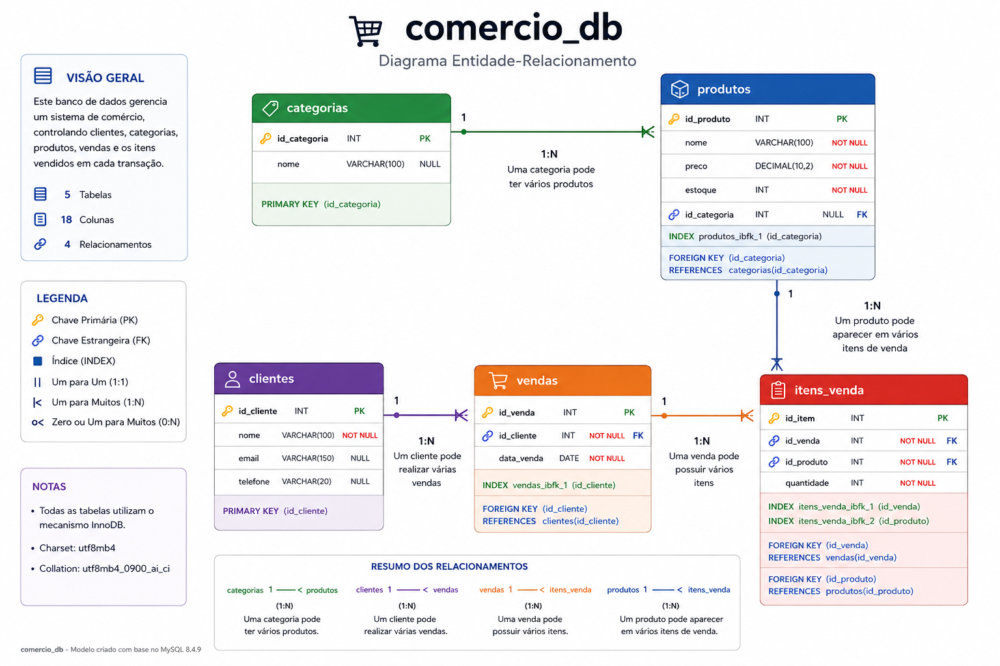

# comercio_db — Banco de Dados Comercial

Projeto educacional de banco de dados relacional em **MySQL**, que representa clientes, categorias, produtos, vendas e itens de venda.

## Tecnologias

- MySQL Community Server 8.4.9 (ou versão compatível)
- InnoDB e conjunto de caracteres `utf8mb4`
- MySQL Workbench ou cliente MySQL equivalente

## Estrutura

O esquema contém cinco tabelas, 18 colunas, cinco chaves primárias e quatro chaves estrangeiras.

| Tabela | Descrição |
|---|---|
| `categorias` | Categorias de produtos |
| `clientes` | Dados de clientes |
| `produtos` | Produtos, preços, estoque e categoria opcional |
| `vendas` | Vendas associadas a clientes |
| `itens_venda` | Produtos e quantidades de cada venda |

Uma categoria pode estar associada a vários produtos; a categoria de um produto é opcional. Um cliente pode realizar várias vendas, e cada venda pode conter vários itens. Produtos podem aparecer em itens de diferentes vendas.

## Diagrama entidade-relacionamento



Os arquivos de diagrama existentes estão em `docs/`: `diagrama_ER_comercio.png` e `diagrama_ER_banco.png`.

## Scripts e carga do banco

Os scripts estão separados por tabela em `comercio_db.sql/`; não há um único arquivo agregado `comercio_db.sql` nem uma pasta `queries/` neste repositório. Os arquivos contêm `DROP TABLE IF EXISTS` e substituem suas tabelas quando executados. **Faça backup antes de executar em um banco com dados que deseja preservar.**

Crie o banco uma vez:

```sql
CREATE DATABASE comercio_db
  CHARACTER SET utf8mb4
  COLLATE utf8mb4_0900_ai_ci;
```

Na raiz deste diretório, execute os scripts abaixo em sequência para respeitar as dependências das chaves estrangeiras. O cliente solicitará a senha do usuário MySQL:

```bash
for arquivo in \
  comercio_db.sql/comercio_db_categorias.sql \
  comercio_db.sql/comercio_db_clientes.sql \
  comercio_db.sql/comercio_db_produtos.sql \
  comercio_db.sql/comercio_db_vendas.sql \
  comercio_db.sql/comercio_db_itens_venda.sql
do
  mysql -u seu_usuario -p comercio_db < "$arquivo" || exit 1
done
```

Os scripts incluem `INSERT` com registros de exemplo.

## Finalidade e privacidade

O projeto serve para estudo de modelagem relacional, tipos de dados, restrições e integridade referencial; não é um sistema pronto para produção. Os scripts contêm informações de contato associadas a nomes. A origem/ficticiedade desses dados não pode ser confirmada apenas pelo repositório: confirme que são fictícios ou substitua/anonimize dados pessoais antes de compartilhar ou publicar os scripts. Não use esses registros como dados de produção.
