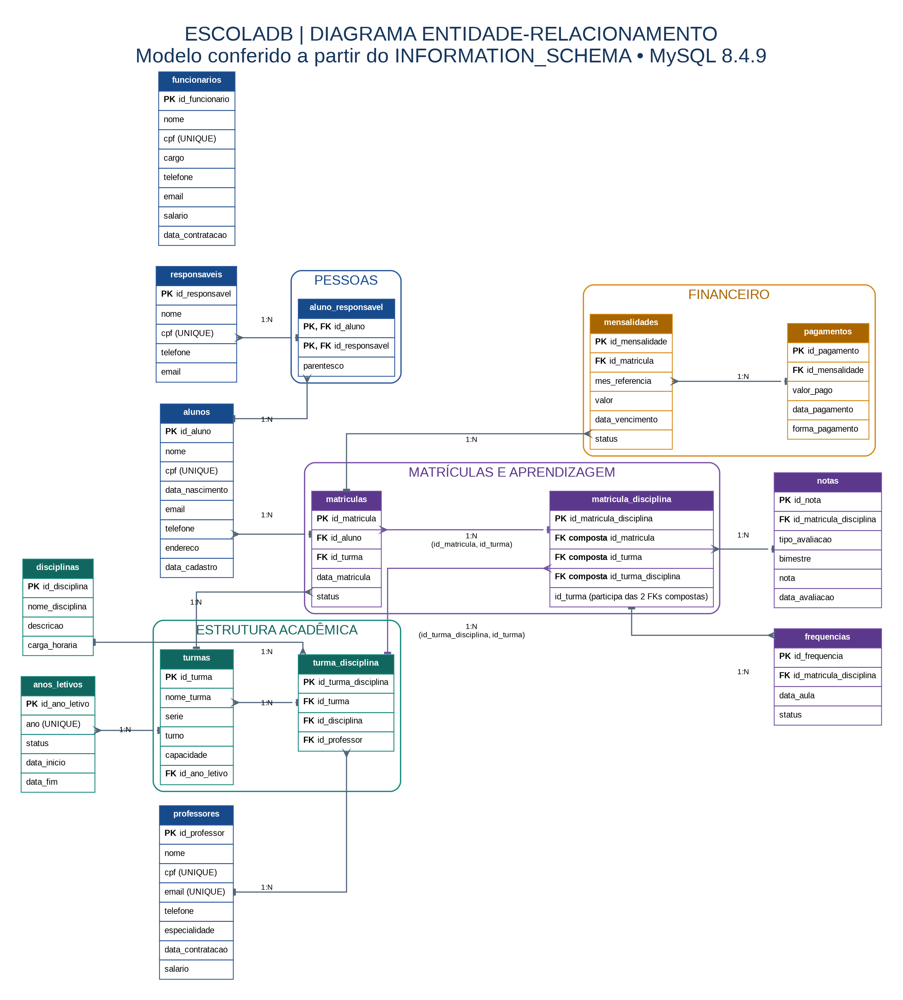

# EscolaDB — banco de dados escolar (MySQL)

O **EscolaDB** é um modelo relacional educacional para organizar cadastros escolares, anos letivos, turmas, matrículas, aprendizagem e cobranças. A estrutura documentada aqui foi conferida com os 15 dumps SQL disponíveis e com o diagrama ER original.

> **Estado desta revisão:** organização e revisão preparadas localmente para conferência. Nada foi publicado no GitHub.

## Finalidade e objetivos

O projeto oferece uma base de estudo para modelagem relacional e SQL em um cenário escolar. Seus objetivos, conforme os objetos presentes no esquema e nos exercícios, são:

- representar alunos, responsáveis, professores e funcionários;
- organizar anos letivos, turmas, disciplinas e a oferta de disciplinas por professor;
- associar alunos a turmas e disciplinas, registrando notas e frequência;
- representar mensalidades e pagamentos;
- praticar chaves, integridade referencial, restrições e consultas SQL.

As finalidades das tabelas são inferidas pelos nomes, colunas e relacionamentos existentes; este projeto não declara regras de negócio além das restrições descritas no script.

## Tecnologias e versões confirmadas

| Item | Informação confirmada |
|---|---|
| SGBD indicado pelos dumps e pelo diagrama | MySQL Server 8.4.9 |
| Utilitário indicado no cabeçalho dos dumps | `mysqldump` 8.0.36 (distribuição Win64 x86_64) |
| Engine das tabelas | InnoDB |
| Charset e collation das tabelas | `utf8mb4` e `utf8mb4_0900_ai_ci` |
| Linguagem | SQL para MySQL |

A versão do utilitário de exportação (8.0.36) é distinta da versão do servidor indicada (8.4.9). Não há evidência nos arquivos de uma versão específica do MySQL Workbench ou de outra ferramenta gráfica.

## Organização

```text
Escola_db/
├── EscolaDB_Diagrama_ER.png
├── escoladb.sql
└── README.md
```

`escoladb.sql` consolida os 15 exports de tabela na ordem necessária para criar as referências. Mantém as instruções `INSERT` dos arquivos de origem. As sete consultas didáticas revisadas estão no final do script como exemplos comentados e não são executadas automaticamente.

## Diagrama Entidade-Relacionamento

A imagem abaixo é o diagrama original existente no repositório; foi movida para esta pasta, sem recriação ou alteração.



## Tabelas

| Tabela | Finalidade inferida | Chave primária |
|---|---|---|
| `alunos` | Cadastro dos alunos, com dados cadastrais e de contato. | `id_aluno` |
| `responsaveis` | Cadastro de responsáveis. | `id_responsavel` |
| `aluno_responsavel` | Associação entre alunos e responsáveis, com parentesco opcional. | (`id_aluno`, `id_responsavel`) |
| `professores` | Cadastro e dados profissionais de professores. | `id_professor` |
| `funcionarios` | Cadastro de funcionários. | `id_funcionario` |
| `anos_letivos` | Cadastro do ano letivo, status e datas de início/fim. | `id_ano_letivo` |
| `turmas` | Cadastro de turmas, série, turno, capacidade e ano letivo. | `id_turma` |
| `disciplinas` | Catálogo de disciplinas, descrição e carga horária. | `id_disciplina` |
| `turma_disciplina` | Oferta de uma disciplina em uma turma e associação a um professor. | `id_turma_disciplina` |
| `matriculas` | Matrícula de um aluno em uma turma, com data e status. | `id_matricula` |
| `matricula_disciplina` | Associação da matrícula às disciplinas ofertadas para a turma. | `id_matricula_disciplina` |
| `notas` | Avaliações e notas associadas a uma matrícula-disciplina. | `id_nota` |
| `frequencias` | Frequência de uma matrícula-disciplina por data de aula. | `id_frequencia` |
| `mensalidades` | Cobranças associadas à matrícula e ao mês de referência. | `id_mensalidade` |
| `pagamentos` | Pagamentos associados a uma mensalidade. | `id_pagamento` |

## Relacionamentos

As chaves estrangeiras declaram os seguintes relacionamentos:

- `aluno_responsavel.id_aluno` → `alunos.id_aluno` e `aluno_responsavel.id_responsavel` → `responsaveis.id_responsavel`: associam alunos e responsáveis; em conjunto, formam uma relação muitos-para-muitos.
- `matriculas.id_aluno` → `alunos.id_aluno` e `matriculas.id_turma` → `turmas.id_turma`: cada matrícula referencia um aluno e uma turma.
- `turmas.id_ano_letivo` → `anos_letivos.id_ano_letivo`: uma turma referencia um ano letivo.
- `turma_disciplina.id_turma` → `turmas.id_turma`, `id_disciplina` → `disciplinas.id_disciplina` e `id_professor` → `professores.id_professor`: a tabela registra a oferta da disciplina e o professor em uma turma.
- `matricula_disciplina` possui duas FKs compostas: (`id_matricula`, `id_turma`) → `matriculas`(`id_matricula`, `id_turma`) e (`id_turma_disciplina`, `id_turma`) → `turma_disciplina`(`id_turma_disciplina`, `id_turma`). `id_turma` participa das duas referências compostas.
- `notas.id_matricula_disciplina` e `frequencias.id_matricula_disciplina` → `matricula_disciplina.id_matricula_disciplina`.
- `mensalidades.id_matricula` → `matriculas.id_matricula` e `pagamentos.id_mensalidade` → `mensalidades.id_mensalidade`.

A tabela `funcionarios` não possui chave estrangeira ou relacionamento declarado nos dumps. As cardinalidades 1:N e N:M decorrem dessas FKs e das tabelas de associação; não são regras comerciais adicionais.

## Chaves e integridade

- **PKs:** cada tabela possui uma PK. Quatorze são identificadores simples; `aluno_responsavel` usa PK composta (`id_aluno`, `id_responsavel`).
- **FKs:** o script declara 14 restrições de FK, incluindo as duas FKs compostas de `matricula_disciplina`.
- **UNIQUE:** há unicidade declarada para `anos_letivos.ano`; campos `cpf` em `alunos`, `responsaveis`, `professores` e `funcionarios`; `professores.email`; e combinações em `turma_disciplina`, `matriculas`, `matricula_disciplina`, `frequencias` e `mensalidades`. Algumas combinações também servem como alvos das FKs compostas.
- **CHECK:** `notas.bimestre` deve estar entre 1 e 4 e `notas.nota` entre 0 e 10.
- **ENUM:** o script restringe valores de status/turno e forma de pagamento nas tabelas correspondentes.
- **DEFAULT:** há valores padrão declarados, entre eles `alunos.data_cadastro = CURRENT_TIMESTAMP`, `anos_letivos.status = 'Planejado'`, `matriculas.status = 'Ativa'` e `mensalidades.status = 'Pendente'`.
- **Nulabilidade:** é definida coluna a coluna no DDL; por exemplo, alguns campos de CPF e contato aceitam `NULL`, enquanto outras colunas são `NOT NULL`.
- **Engine/encoding:** InnoDB, `utf8mb4` e `utf8mb4_0900_ai_ci` são declarados nos dumps.

As declarações de FK não especificam `ON DELETE` ou `ON UPDATE`; portanto, o script não configura ações em cascata. Também não há outras restrições `CHECK` além das duas de `notas` identificadas acima.

## Conceitos SQL presentes

O material utiliza `CREATE DATABASE`, `CREATE TABLE`, `DROP TABLE IF EXISTS`, `INSERT INTO`, PK, FK, `UNIQUE`, `CHECK`, `DEFAULT`, `ENUM`, `SELECT`, `WHERE`, `ORDER BY`, `INNER JOIN`, `COUNT()`, `AVG()` e `GROUP BY`. As consultas são exemplos didáticos baseados no arquivo de exercícios original.

## Execução com MySQL

Use MySQL 8.4.9, versão indicada nos dumps e no diagrama. Em um terminal, na pasta do projeto:

```bash
cd Escola_db
mysql -u SEU_USUARIO -p < escoladb.sql
```

O usuário MySQL precisa ter permissão para criar o banco `escoladb` e as tabelas. O script cria o banco se ele ainda não existir e seleciona `utf8mb4` com `utf8mb4_0900_ai_ci`.

> **Atenção:** o script contém `DROP TABLE IF EXISTS` para as 15 tabelas e as recria, carregando os `INSERT` preservados dos dumps. Executá-lo em uma base `escoladb` existente substitui os dados dessas tabelas. Faça backup antes de executar.

## Exemplos de consultas revisadas

As consultas abaixo foram encontradas no arquivo de exercícios e estão incluídas como comentários opcionais no final de `escoladb.sql`.

**Contar alunos:**

```sql
SELECT COUNT(*) AS total_alunos
FROM alunos;
```

**Listar alunos e suas turmas:**

```sql
SELECT a.nome, t.nome_turma
FROM alunos AS a
INNER JOIN matriculas AS m ON m.id_aluno = a.id_aluno
INNER JOIN turmas AS t ON t.id_turma = m.id_turma;
```

**Contar matrículas por turma, distinguindo turmas que tenham o mesmo nome:**

```sql
SELECT t.nome_turma, COUNT(*) AS total_alunos
FROM matriculas AS m
INNER JOIN turmas AS t ON t.id_turma = m.id_turma
GROUP BY t.id_turma, t.nome_turma;
```

**Calcular a média das notas por disciplina:**

```sql
SELECT d.nome_disciplina, AVG(n.nota) AS media_notas
FROM notas AS n
INNER JOIN matricula_disciplina AS md
  ON md.id_matricula_disciplina = n.id_matricula_disciplina
INNER JOIN turma_disciplina AS td
  ON td.id_turma_disciplina = md.id_turma_disciplina
 AND td.id_turma = md.id_turma
INNER JOIN disciplinas AS d ON d.id_disciplina = td.id_disciplina
GROUP BY d.id_disciplina, d.nome_disciplina;
```

### Ajustes feitos nos exercícios

- A instrução exploratória `SELECT * FROM matricula` foi corrigida para usar o nome real `matriculas`.
- A contagem por turma agrupa também por `id_turma`, evitando juntar turmas diferentes com o mesmo nome, sem presumir que `nome_turma` seja único.
- A questão 7, que tinha `AVG()` e `FROM/JOIN` incompletos, foi completada com as FKs declaradas no modelo, incluindo as duas colunas da relação composta com `turma_disciplina`.
- A consulta de CPF mantém `cpf IS NOT NULL`, pois esse é o filtro original e é SQL válido. Essa condição não exclui valores vazios ou contendo apenas espaços; o esquema não define uma regra adicional de validação.

## Observações e próximos passos

1. Os dumps contêm instruções `INSERT` com registros do conjunto original. O esquema inclui categorias de dados pessoais e sensíveis, como nome, CPF, e-mail, telefone, endereço e data de nascimento, além de dados acadêmicos, financeiros e salariais. Os valores não são reproduzidos neste README. **Antes de qualquer publicação, revise esses registros e substitua-os por dados sintéticos/anonimizados apropriados ou obtenha autorização. Nenhum envio ao GitHub foi feito nesta revisão.**
2. As regras de cascata não estão configuradas explicitamente. Uma evolução pode avaliar ações `ON DELETE`/`ON UPDATE` com base em requisitos de negócio documentados.
3. O esquema não declara validação de formato para CPF/e-mail, nem outros limites `CHECK` além dos campos de nota e bimestre. Melhorias desse tipo devem ser definidas conforme as regras pretendidas, sem presumir valores.
4. A lista de exercícios pode ser ampliada com consultas de relatórios acadêmicos e financeiros. As novas consultas devem ser testadas contra regras de negócio confirmadas.
5. O modelo pode ganhar documentação explícita para tabelas sem relacionamento, como `funcionarios`, e para regras que hoje são apenas inferidas pelos nomes e colunas.
